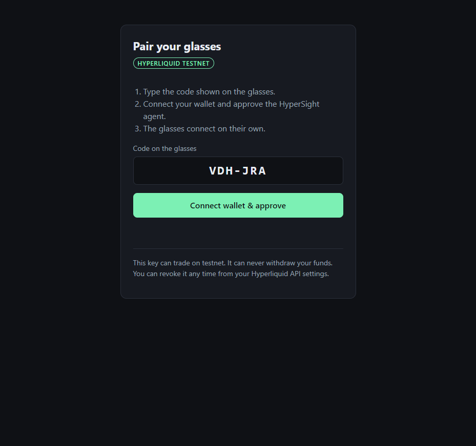

# HyperSight

**Glance at the one number that matters. Act on it with one tap.** A Hyperliquid **testnet** copilot for Even Realities G2 smart glasses, covering perpetuals and HIP-4 outcome (prediction) markets. Read a position, the odds or your PnL without touching the phone; close half, buy YES or cancel everything with a tap or a short phrase, always behind a confirm card. A trade call posted in a Telegram chat you follow shows up on the glasses with the trade already proposed.

> **Testnet only.** Orders are signed by a Hyperliquid API (agent) wallet that can place and cancel orders but can never withdraw funds. Hard risk limits apply to every order. Suggestions only ever come from rules you wrote yourself or from Telegram chats you chose to follow, sized by your own presets. Nothing here is financial advice.

Built for the *Heads Up: Even Realities* hackathon (Crypto & DeFi · Messaging & News: Telegram + Hyperliquid in one flow), Nov 23–29, 2026.

▶ **[Watch the demo video (2 min)](https://youtu.be/oTGkwU4cZ1o)**: every trade in it is real, on Hyperliquid testnet.

| Deck | Actions | Confirm | Result |
|---|---|---|---|
|  |  |  |  |

| Outcome buy on testnet | Pair the glasses | Approve the agent |
|---|---|---|
|  |  |  |

## Four moments

1. **Trading on the move.** An ETH long is open; the card reads size, PnL and liquidation price. Your own take-profit rule fires: *"ETH +5.5% · your rule: take half"*. One tap → confirm card → `Filled`.
2. **Watching the game.** You hold YES on a market. Say *"sell half my Hawks"* → the confirm card shows shares, price and proceeds → tap.
3. **Macro event.** *"What are the odds on the Fed?"* → `Change 71% · No change 29%`. *"Buy twenty dollars of yes"* → confirm → tap.
4. **A call in your trading group.** Someone posts *"longing ETH here"* in a Telegram group you follow. The glasses show *"TELEGRAM · Alpha calls"* with the message and *"→ Long ETH $50 at 2×"* (your preset size, never the size in the message). Tap → confirm → `Filled`, and if you asked for it the bot replies to the call: *"✅ Long ETH $50 at 2× · Filled …"*.

With `VOICE_LANG=multi` voice also understands Spanish (*"cerrá la mitad de mi eth"*, *"¿cuánto gano?"*); the default transcribes English only. Every action is also reachable by tap: voice is never required.

## How it works

```
 G2 glasses ⇄ BLE ⇄ Even app WebView ───────────────┐
   text cards, R1/temple input, mic PCM              │  one WebSocket (JSON + binary audio)
   + phone companion (watchlist, limits, alerts,     ▼
     Telegram chats)
                                       HyperSight server (Node 24, TypeScript)
                                       ├─ session    per-device state, resume after reconnects
                                       ├─ market     Hyperliquid info + WebSocket (mids, books, account, fills)
                                       ├─ outcomes   HIP-4 catalogue → human questions, watchlist
                                       ├─ voice      PCM → ElevenLabs Scribe v2 Realtime → transcript
                                       ├─ intent     fast grammar (EN/ES) → Claude structured output fallback
                                       ├─ proposals  intent → sized, risk-checked confirm card → execute once
                                       ├─ risk       testnet guard, caps, slippage, write rate limit
                                       ├─ exec       Hyperliquid exchange via the agent wallet (testnet) | paper
                                       ├─ alerts     your rules over live data → alert card + suggested action
                                       ├─ telegram   bot long polling → followed chats → trade calls → alert cards, fill replies
                                       ├─ store      SQLite (node:sqlite): settings, rules, audit log, devices, chats
                                       └─ http       companion API, /link pairing page, /health
```

- **Write path.** Every write is a proposal: priced from the live book, sized to whole shares or valid perp sizes, checked against your limits, shown as a confirm card with a 15-second deadline. A tap executes it exactly once; if the price moved past the order's limit, you get a fresh card instead of a failed order. An unknown outcome (timeout) says *check positions*, never *try again*.
- **Voice.** Push-to-talk maps to a manual commit on the speech-to-text stream, so the transcript arrives right after you let go (≈ 0.25 s in the simulator). A deterministic grammar handles the common phrases instantly; Claude only parses what the grammar cannot, and every amount it returns must have been said.
- **Alerts.** Price crosses, odds moves, PnL thresholds, liquidation distance, fills and stops hit, settled markets. An alert never covers a confirm card; it waits and shows when you are free.
- **Telegram signals.** Add the bot to a group or channel; it shows up on the phone, where you turn on *Follow* (and optionally *Reply when filled*). Calls like *"longing ETH here"*, *"short sol"*, *"closing half my eth"*, *"buying no change on the fed"* or *"compro yes en bitcoin"* become an alert with the trade proposed; call-out posts with entry, targets and leverage count as a plain open. Size and leverage always come from your presets, a close or sell needs a position you hold, and the parser is deterministic (no LLM reads chat messages). It ignores negations and advice against a trade (*"don't long eth"*, *"avoid shorting sol"*), questions and conditionals (*"should I long eth?"*, *"long eth if it holds 2400"*), idioms (*"short-term bullish"*, *"short squeeze"*), status updates (*"TP1 hit"*, *"SL hit"*) and messages older than three minutes (the backlog Telegram hands back after a restart).
- **Measured on testnet:** tap → `Filled` in 1.5–2.3 s (outcome buys and sells through the real exchange).

## Safety model

- **No custody, no master key.** The server only holds an agent wallet key you approved. Agent wallets can trade for your account but cannot withdraw or transfer funds to other addresses. The approval expires (30 days when paired) and you can revoke it from Hyperliquid at any time.
- **Pairing without secrets in config:** with `PAIRING=1` the glasses show a code; you open `/link` on a computer, connect your wallet and approve a fresh agent the server generated. The server checks on Hyperliquid that the agent belongs to your wallet before trading with it. Agent keys are sealed at rest (AES-256-GCM); device tokens are stored only as hashes.
- **Testnet hard guard.** Any Hyperliquid URL off `hyperliquid-testnet.xyz` is refused at startup; mainnet is not configurable.
- **Confirmation for every write,** with expiry and a price re-check at tap time.
- **Risk limits:** $250 per order, $2,000 per day, 5× leverage and the allowed coins are editable on the phone; 1% perp / 3-tick outcome slippage and one write per 2 s are fixed.
- **Kill switch:** *Cancel orders* in the glasses menu.
- **No advice:** suggestions come only from your own rules (they read *"your rule: …"*) or from Telegram chats you follow (they show the sender and the message). Every proposal, confirm and result is in the audit log (History on the phone).
- **Telegram is opt-in and read-only by default:** chats start unfollowed, nothing runs without your confirm, the size never comes from the message, message text is never stored (only chat id, title, type and your two toggles), and the bot only writes in a chat where you turned on *Reply when filled*.

## Run it (5 steps)

Requires Node 24, pnpm 12 and, for the glasses preview, `evenhub-simulator`.

1. `cp .env.example .env` and fill it in: `HL_ACCOUNT_ADDRESS` plus either `HL_AGENT_PRIVATE_KEY` (an approved testnet API wallet) or `PAIRING=1` (the address then pins the only account allowed to pair); plus `ENCRYPTION_KEY` (`openssl rand -hex 32`) and `SESSION_TOKEN`. `ANTHROPIC_API_KEY` and `ELEVENLABS_API_KEY` are optional (without them: grammar only, tap only). `TELEGRAM_BOT_TOKEN` is optional too: create a bot with @BotFather, turn its privacy mode off (`/setprivacy` → Disable) so it reads group messages, add it to a group and follow that chat from the phone.
2. `pnpm install`
3. `pnpm --filter @hypersight/link build && pnpm --filter @hypersight/server start`
4. `pnpm --filter @hypersight/hud dev`
5. `evenhub-simulator http://localhost:5173` — or open the HUD from the Even app on your phone (whitelist your server's origin in `apps/hud/app.json`).

Checks: `pnpm lint && pnpm typecheck && pnpm test`. `pnpm e2e` runs the whole stack against captured market data with a fake executor and drives the simulator through deck → actions → confirm → result (no `.env` needed).

Container: the `Dockerfile` builds the server bundle and the link page (SQLite lives on the `/data` volume, configured through the same environment variables); `fly.toml` deploys it to Fly.io.

Glasses package: `VITE_SERVER_WS=wss://<your-host>/ws pnpm --filter @hypersight/hud build`, then `evenhub pack apps/hud/app.json apps/hud/dist -o hypersight.ehpk --sdk-ver 0.0.16`. The host must be in the network whitelist of `apps/hud/app.json`; the package never contains a token (the glasses pair with a code).

## Repository layout

| Path | What |
|---|---|
| `packages/protocol` | Shared zod schemas: WebSocket messages, cards, intents, settings |
| `apps/server` | Hyperliquid data and execution, speech-to-text, intent parsing, risk, alerts, pairing |
| `apps/hud` | Even Hub plugin (cards on the glasses) and the phone companion |
| `apps/link` | Pairing page: approve the trade-only agent with your wallet |
| `scripts/` | Simulator helpers and the end-to-end smoke test |
| `docs/` | Research notes, demo script, feature requests, submission text, screenshots |

## Built during the hackathon

- **Before Nov 23, 2026 (allowed preparation, no product code):** API research notes in `docs/research/` and throwaway spikes whose conclusions are recorded in `docs/research/spike-results-2026-11-20.md` (their code is not in this repository).
- **From Nov 23, 2026:** all code in this repository.
- Third-party open-source libraries are used as declared in each `package.json`; the HUD starts from the official Even Hub minimal template.
